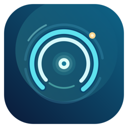

# TunnelSentinel

**让网络守护安静运行，让异常有迹可循。**

为 macOS 打造的轻量菜单栏守护工具。监控 Shadowrocket → ChatGPT / Codex 的连接状态，提供本地诊断与谨慎恢复。

---

## v1.6 · 只有一个 TunnelSentinel 应用

2026-10-25 起，**节点故障转移控制器已直接集成进 `TunnelSentinel.app`**，不再需要、也不再安装 `TunnelSentinelRouteController.app`。用户可见的唯一应用是 `~/Applications/TunnelSentinel.app`；内部 Python Guardian 仅负责后台日志采集和基础探测，不再请求其他应用的辅助功能权限。原独立自动换线 LaunchAgent 已停用并从启动项移走，旧辅助 App 仅保留在不对用户展示的诊断备份中。

菜单栏提供 **「节点故障转移 · 状态」** 与 **「开启／关闭 Codex 自动故障转移」**。第一次启用可能需要 macOS 系统设置 → 隐私与安全性 → 辅助功能 → **TunnelSentinel** 授权；不要授权 Python 或旧 Route Controller。此权限只能由用户批准。原应用使用稳定 Apple Development 签名，减少更新后失效的可能性。

监测来自 Guardian 的 Codex 最近 210 秒真实流式故障，3 次及以上才符合切换条件。由 TunnelSentinel Swift 进程使用 Shadowrocket 的原生辅助功能界面读取当时实际使用的 `OpenAI-Resilience` 节点、排除故障候选、保存并回读，之后观察实际组内节点是否改变。每次至少保留两台候选、10 分钟冷却、最多两次排除、单次失败停止升级，基础公共入口故障时尝试一次回滚。**截至当前尚未通过自然故障下的完整业务恢复验收**，不要将编译或单格保存测试视为恢复必然成功；当 Shadowrocket 页面不可访问、macOS 未授权或屏幕锁定时，控制器会安全退出并显示阻塞，不会假报换线成功。已有连接不会因测试被强制断开。

## 看得见问题，才谈得上恢复

**公共入口能打开，不等于 ChatGPT 一定好用。** TunnelSentinel 把代理基础连通性和桌面客户端业务异常分开检测：即使网络入口返回 HTTP 200，客户端出现 Cloudflare 验证、429 限流或连接关闭时，面板也能给出不同的提示。

<table>
  <tr>
    <td width="50%"><strong>◉ 链路守护</strong> 巡检本地代理和公共入口。持续故障时按阈值与冷却时间谨慎恢复，尊重用户手动断开。</td>
    <td width="50%"><strong>⌁ 业务诊断</strong> 读取本机相关错误日志，将验证、限流、连接中断与界面异常分类呈现。</td>
  </tr>
  <tr>
    <td><strong>◈ 原生状态面板</strong> 菜单栏查看链路、节点和近期错误。单色 Template 标志随 macOS 外观自动适配。</td>
    <td><strong>◇ 克制的自动恢复</strong> 不会因为一次 Cloudflare 403 或 HTTP 429 就盲目切换节点。</td>
  </tr>
</table>

## 菜单栏状态

菜单栏标志现在**直接显示与面板右上角徽标相同的状态文字**（例如“● 基础正常”“! 需留意”“! 需人工处理”）。文字颜色由 macOS 自动管理，以便在浅色、深色菜单栏和选中状态下保持可读性；点击仍可查看细分诊断信息。

**外观适配：** 展开菜单内的状态卡片、节点信息框、分隔线和徽标背景均随菜单实际浅色／深色外观动态绘制，避免系统菜单文字已经切为深色而卡片背景仍保留黑色的低对比度问题；不需要强制固定整个应用为浅色模式。

**双节点视图：** 启用 Shadowrocket 原生 `fallback` 后，菜单栏同时展示健康状态、`出 US-SEA`（最近一次实际 OpenAI 请求的出口观测）、`全 Japan 04`（Shadowrocket 的全局手选节点）；点击后分别显示出口 IP/Cloudflare 机房编码以及完整的全局节点名。**出口 IP 和 Cloudflare `colo` 不能唯一确定机场订阅节点名称**；没有来自 Shadowrocket 的独立节点名证据时，界面会明确标注“非节点名”，绝不将历史上显示过的 `Seattle 05` 固定为当前后端。探测失败、状态过期时，出口显示“待确认”，不会沿用旧 IP；如果 macOS 限制读取 Shadowrocket 最新全局选择，则界面将最近确认过的名称标为“上次记录”，而不伪称实时。

| 状态 | 含义 |
| :-- | :-- |
| **基础正常** | 公共代理入口可达，近期没有识别到业务错误；不保证每次聊天一定成功 |
| **需留意** | 代理可达，但客户端近期出现了验证、限流或连接等错误 |
| **连接异常** | 代理端口或公共入口探测失败，守护程序按既定规则恢复 |
| **节点检测中** | 节点已变化，新节点的健康状态尚未复核 |
| **节点未核实** | macOS 限制读取 Shadowrocket 节点，只展示明确标注的上次记录 |
| **待检测 / 暂停 / 离线** | 状态未更新、用户暂停或守护服务未运行 |

菜单中的 **「查看 GPT 节点状态与事件」** 提供三个视图：「GPT 节点状态」区分最近真实请求记录、人工确认的历史节点和全局选择（无法读取时标为上次记录）；「最近运行日志」展示筛选后的 GPT 请求及节点观测；「异常与切换」展示公共入口中断、出口变化和证据不足的情况。只有在 Shadowrocket 原生代理日志可读、记录未超过 10 分钟且确实匹配 GPT 域名时，才显示“最近请求节点”；该名称不表示后台选路状态被持续实时监控。目前后台原生日志读取开关关闭，不能据此把历史节点标为当前节点。

近期业务告警使用约 **3 分钟滚动窗口**。客户端一时重连不意味着代理应该切换；连续断线另有独立宽限机制。客户端日志中明确出现的 **会话列表同步失败（例如 authenticated thread catalog 的 HTTP 403）** 也会单独提示，便于发现“公共入口正常、历史会话仍无法加载”的情况。此类 403、Cloudflare 验证和 429 都不会单独触发节点切换，避免反复更换出口加重验证问题。

> **关于 Cloudflare 验证：** 未携带登录态的命令行请求可能正常遇到 HTTP 403。TunnelSentinel 不读取 Cookie、令牌或聊天内容，因此使用公开入口验证基础连通性，并以真实桌面端日志辅助判断业务异常。

## Codex 响应流故障监测（v1.5.5）

TunnelSentinel 还会独立检查 Codex 的原生运行诊断：`~/.codex/logs_2.sqlite`。在显式开启 `codex_stream_sqlite_monitor_enabled` 时，只以只读 SQLite、有限扫描范围和 **2.5 秒子进程超时**统计最近 30 分钟的 Broken pipe、WebSocket 握手失败、Connection reset 次数与最近出现时间；不输出聊天正文、代码、密钥、请求 ID 或原始日志。故障会以 **“Codex 近30分钟响应流中断”** 出现在业务状态中，与公共 URL 可达性独立。

**重要：** v1.5.5 不会因为 Codex 错误直接修改代理或轮换节点。Shadowrocket 原生 `OpenAI-Resilience` fallback 仍按自身测试 URL 选择**第一个可用节点**。在 2026-10-25 15:20–15:45 本机日志中，四个候选均接受周期测试，策略始终选择 Seattle 05；Codex 实际同时出现 Broken pipe、握手失败，说明只测公共入口不能证明流式对话稳定。临时调整路由需在 **Shadowrocket 分组本身**改变优先候选，单独更改全局节点不等于改变 GPT 分组。

## AI 多站点分流检测

TunnelSentinel 内置参考 [Nexitally AI 分流测试](https://nxonearth.com/aitest.html) 的**公共 Trace 观测方法**，在本机经过现有 Shadowrocket 代理，低频检查 ChatGPT、OpenAI、Sora、Claude、Grok、Anthropic、Perplexity 等网站。菜单中的「AI 分流检测」可查看每个目标的可达状态、出口地区及响应耗时。默认测试间隔约 15 分钟，和基础链路检查相互独立，不需要提交订阅链接、账号或聊天内容。

请区分三种证据：

- **站点可达：** HTTP 200 且返回有效出口 IP；只能说明公共入口通过，不能证明网页能登录或完成一次 ChatGPT 对话。
- **出口一致或分开：** 同一次巡检不同目标可能分别走美国、日本等地区，这是分流结果，不一定是故障；IP/地区不是订阅节点的准确名称。
- **自动切换：** 由 Shadowrocket 的 `OpenAI-Resilience` 原生 `fallback` 分组根据其配置的 ChatGPT 公共检测地址进行，TunnelSentinel 的多站点数据只用于显示和排查。不能用第三方网页数据直接推断某个未连接节点已解锁，也不因单次 403/429 或其他 AI 网站检测失败就反复换节点。

**限制：** 上述网页并没有提供带节点名称、检测时间和判定结果的可用历史接口；它在访问者浏览器中即时运行检测。本项目实现相同思路的本机观测，**不是抓取供应商的实时节点解锁名单**。未经真实节点验证不展示“节点 ChatGPT 已解锁”的承诺。

**节点适配研究：** 目前保留 Shadowrocket 原生 `fallback` 做唯一选路，支持单 URL 的逐候选自动健康测试。研究阶段发现，当前出口对 `/cdn-cgi/trace` 的 `GET` 返回 200，但 `HEAD` 返回 Cloudflare 403；如果原生组测试也使用 HEAD，可能出现误判。具体边界、可复现对照与下一项安全验证见 [ChatGPT 节点健康资格研究](research/chatgpt-node-eligibility-20261023.md)。在原生组测试方式确认前不擅自更换活动检测 URL。 Mac 版 2.2.92 实机核对：当前手动延迟测试方式是 **TCP**；手动“代理分组 → 测试”的结果不代表后台自动测试，因此目前还不能断言 `fallback` 正在用 HEAD 或因此误判。

TunnelSentinel 还提供**可选的 HEAD/GET 方法差异诊断**：开启 `endpoint_method_audit_enabled` 后，约每 15 分钟随 AI 分流检测额外进行一次当前出口的 HEAD 测试；遇到 GET 200、HEAD Cloudflare challenge 时，菜单详情明确提示“可能存在健康测试误判”。此功能默认关闭，不参与节点切换，不读取订阅/登录信息，也不能证明 Shadowrocket 原生分组后台一定使用 HEAD。

## 快速开始

**要求：** macOS、Shadowrocket、Python 3，以及可访问的本地 HTTP 代理（默认端口 1082）。

在已经获取的项目仓库根目录：

~~~sh
# 安装后台守护并设置登录自启
./install.sh

# 安装原生菜单栏程序、品牌图标和应用程序
./install-menubar.sh
~~~

应用安装在 **~/Applications/TunnelSentinel.app**；配置和运行状态仍保存在用户目录下的 **Library/Application Support/OpenAILinkGuardian**。升级菜单栏程序不会要求重启 ChatGPT、Codex 或 Shadowrocket。

## 设计与图标

 
信号轨道 · 守望信标 · 深海蓝与薄荷青

菜单栏使用与品牌图标同源的**透明单色标志**，由系统按浅色、深色和选中状态自动着色；展开面板才使用绿色、橙色与红色表达健康状态，避免菜单栏文字对比度不足。

| 资源 | 用途 |
| :-- | :-- |
| <code>branding/AppIcon.icns</code> | 原生 App 在 Finder 中显示的图标 |
| <code>branding/MenuBarTemplate.png</code> | 状态栏自适应单色标志 |
| <code>branding/GenerateBranding.swift</code> | 可重复构建的矢量几何源码 |
| <code>branding/ReadmeIcon.png</code> | README 品牌预览 |

在 Mac 上运行 <code>./branding/build-assets.sh</code> 可重新生成所有资源。

## 从异常检测到恢复

TunnelSentinel 把**代理基础链路**、**ChatGPT 客户端错误**和**节点切换权**分开处理。

- 基础网络：正常情况下约每 30 秒检查一次，出现连续失败后约每 10 秒检查一次。
- 业务层：观察 Cloudflare 验证、HTTP 429、长连接中断等真实客户端错误；这些事件不会单独触发节点切换。
- **原生故障转移模式**：若 Shadowrocket 的 `fallback` 分组已经在当前规则中正确启用，由 Shadowrocket 自身决定 OpenAI 出口节点，TunnelSentinel 不再发送外部 `shadowrocket://select` 指令，避免双重控制。
- 传统模式：仍保留有界恢复与候选节点检查，但 macOS 上外部选择指令的成功回执不等于真正切换，不能承诺其一定可用。
- 全局节点名称与 OpenAI 规则组所选择的实际出口**可能不同**，菜单会明确区分两者。

> 公共探测 HTTP 200 和分流规则命中均不能替代断网条件下真实切换测试，也不能保证账号限流、Cloudflare 验证或 ChatGPT WebSocket 会自动恢复。

## 守护流程

~~~text
Shadowrocket 本地代理
    ├─ 公共入口可达性 ──→ 链路健康 ──→ 故障告警 / 复核
    ├─ 原生 fallback 模式 ──→ Shadowrocket 自主选路（不做外部强制换节点）
    └─ ChatGPT / Codex 桌面日志 ──→ 近期业务告警 ──→ 菜单栏诊断
                                             （不触发盲目换节点）
~~~

| 默认设置 | 数值 |
| :-- | --: |
| 基础网络巡检 | 正常每 30 秒；故障期间约每 10 秒 |
| 长连接断开宽限 | 45 秒 |
| 故障累计窗口 | 150 秒 |
| 切换阈值 | 窗口内 3 次失败（业务限流不累计） |
| 基础切换冷却 | 至少 5 分钟 |
| 失效控制通道的重试退避 | 15 分钟 |
| 候选节点成功记录窗口 | 72 小时 |
| 菜单健康状态读取 | 每 5 秒 |
| 节点信息尝试更新 | 约每 2 秒，受系统权限影响 |

**最近一次公共入口恢复留证：** 守护后台在发现入口探测失败、随后恢复时，会在本地 `status.json` 记录 `last_public_edge_incident`（采样中断时间、恢复前后出口 IP、是否观察到出口变化）与 `public_edge_outage_pending`。它只证明公开探测的状态变化，`native_backend_switch_verified` 恒为 `false`，直到有独立的 Shadowrocket 原生切换证据；不会据此强制换节点，也不会读取聊天正文。手动断开隧道不计入自动切换案例。

**自然故障的出口变化历史：** 同一公共入口健康探测若连续两次观察到不同的稳定出口 IP，会把最近 6 次变化记录到本地 `egress_change_history`，并注明变化时附近是否发生入口中断。它既不额外发起探测，也不控制节点；展开「AI 分流检测」可查看最近一条变化记录。**机场可能在同一节点下轮换出口 IP**，因此该记录不等于节点身份变化或原生 fallback 切换成功的证据。

**GPT 实际节点日志：** v1.5.4 已接入 Shadowrocket 原生「数据 → 代理」产生的**本地代理日志数据库**。只读提取命中 `OpenAI-Resilience` 的 `chatgpt.com / *.chatgpt.com / openai.com / *.openai.com` 请求记录中的节点名、域名和时间；不提取其他网站、User-Agent、完整 URL、聊天消息或订阅凭据。**最近 10 分钟真实请求**会在菜单栏优先显示 `GPT Seattle 05 · 全 Japan 04` 这样的双节点信息，过期后降级为“上次记录”及出口地区。事件窗口优先列出真实 GPT 节点名及不同节点请求的时间线，另保留出口 IP/位置供排障。即使记录出现不同节点，也只能证明真实请求分别使用了不同节点，**不能单凭此断言是 fallback 自动切换而非用户手动调整**。

此功能在源码默认关闭，通过明确的本机配置 `native_proxy_log_reader_enabled` 开启。它**不会代替你开启 Shadowrocket 日志**；只有 Shadowrocket 本身允许记录，才能持续收到新节点证据。读取使用短期子进程（2.5 秒超时）与只读 SQLite，发生权限拒绝或日志关闭时回退为上次记录，绝不影响守护主循环或自动换节点。要持续看到新请求的节点名，需要自行决定是否继续开启 Shadowrocket 代理日志；该程序可能记录访问元数据，不建议无必要长期打开。

**macOS 权限说明：** 后台 LaunchAgent 访问 Shadowrocket 的 App Group 目录需要系统“访问其他 App 数据”的授权。当前 Mac 上，交互式一次性读取已成功，但后台守护进程读取触发权限等待并超时。为避免频繁弹窗，已暂停**实时原生节点读取开关**（不影响原生 fallback），当前只展示“上次确认 Seattle 05”等历史证据。如果愿意持续授权，请由用户通过 macOS「系统设置 → 隐私与安全性 → App 管理」审慎确认对应的 Python 守护程序；这类权限可能允许程序访问超出 Shadowrocket 的其他应用数据，**不应为了一个节点名称盲目授予**。也可以等待后续开发可由用户自主选择日志目录的专用读取器，不需修改 Shadowrocket 内部数据库或绕过系统隐私保护。

**更换订阅时：** 原生组开启订阅后候选会随**所绑定的那一个订阅**更新，但改用另一机场/另一个订阅不会自动改绑定。新订阅名称也可能不匹配原来按 `Japan 04 / Seattle 05` 等名字写的正则，甚至留下空组。更换前保留原订阅作为回退，换后在 Shadowrocket 的「配置 → 代理分组 → OpenAI-Resilience」重新选择「服务器节点」，检查正则和候选数量，再用「测试规则」确认 ChatGPT 域名仍命中组。TunnelSentinel 不会自行读取/导出订阅密钥，也不在无证据时自动绑定新机场。只有获得 Shadowrocket 稳定、只读的订阅/组状态 API，才能可靠判断并自动提示名单变化。

**节点读取权限边界：** 部分 macOS 版本会限制第三方进程访问 Shadowrocket 的 App Group 偏好设置。工具会限制读取耗时，并在系统阻塞时停止自动重试；此时节点显示为“未核实”，但基础链路巡检仍继续进行。这里的 2 秒是权限允许时的目标，不是所有设备上都已实现的保证。

## Shadowrocket 原生故障转移（分阶段启用）

为提升无人值守的故障恢复能力，更合适的方案是让 Shadowrocket 自身的 `fallback` 代理组决定每条请求使用哪个节点，而 TunnelSentinel 独立观察链路与 ChatGPT 客户端诊断。这样可以避免额外的节点选择 URL 在 macOS 上失效导致连续盲试。

本仓库提供不包含订阅密钥的 [fallback 配置片段](examples/shadowrocket-openai-fallback.fragment.conf) 和 [安全启用与回退步骤](research/shadowrocket-native-failover.md)。安装程序**不会直接修改 Shadowrocket 配置**；分组必须通过 Shadowrocket 自身的配置机制创建，确保规则确实命中再启用。

2026 年 10 月的本地试点已验证：在保留原配置的前提下创建了 `OpenAI-Resilience` 组，启用测试配置后 `chatgpt.com`、`ws.chatgpt.com`、`api.openai.com` 都命中该分组，公共入口测试返回 HTTP 200。另提供 [OpenAI 业务域名补充分流片段](examples/shadowrocket-openai-domain-overlay.fragment.conf)，只预置两个 OpenAI 专属域名；共享 Cloudflare、WorkOS 域名须先验证真实命中再决定是否调整。片段不会自动应用；详细核查见 [分流与恢复审计](research/openai-route-and-failover-audit-20261023.md)。**强制使首选节点失效后的自动改选尚未验收**，不可把此次试点当作零中断保证。

## 配置与事件记录

运行配置位置：<code>~/Library/Application Support/OpenAILinkGuardian/config.json</code>

~~~json
{
  "proxy": "http://127.0.0.1:1082",
  "check_interval_seconds": 30,
  "failure_window_seconds": 150,
  "failures_before_switch": 3,
  "switch_cooldown_seconds": 300
}
~~~

以上只是部分选项；请在本机维护具体节点及后备顺序。自动恢复会跳过最近没有成功记录的旧名称，配置的优先级不会跳过实际健康验证。修改配置后需重新加载后台守护。

~~~sh
cat "$HOME/Library/Application Support/OpenAILinkGuardian/status.json"
tail -f "$HOME/Library/Logs/OpenAILinkGuardian/guardian.log"
~~~

菜单中的 **「立即检查链路」** 会请求正在运行的后台进行新一轮检测，不会重启其他应用。**「查看事件日志」** 则展示近期检测、失败与切换记录。

<strong>开发与测试</strong>

 

~~~sh
python3 -m unittest discover -s tests -v

swiftc -parse-as-library -O -framework AppKit \
  menubar/TunnelSentinelMenu.swift -o /tmp/TunnelSentinelMenu-preview

./branding/build-assets.sh
~~~

自动化测试与 Swift 编译只能验证代码行为；真实菜单布局、Finder 图标和不同 macOS 权限环境中的节点同步仍需要实机验收。

<strong>停止、卸载与隐私</strong>

 

- 在菜单中暂停自动守护，不会同时关闭 Shadowrocket。
- <code>./uninstall.sh</code> 移除守护服务，保留用户配置与日志。
- 如需单独停用菜单栏，可通过 <code>launchctl bootout gui/$(id -u)/com.wuwendi.tunnelsentinel-menu</code> 停止，然后按需手动移除 <code>~/Applications/TunnelSentinel.app</code>。
- 不读取聊天正文、Cookie、登录令牌或 Shadowrocket 订阅密钥；不自动修改订阅。

---

**TunnelSentinel · Quietly watching the connection.**

本地优先 · 适度恢复 · 不以漂亮的「正常」掩盖真实故障

### 当前自动恢复架构 · TunnelSentinel v1.6.0（2026-10-25）

**仅有一个需要用户管理的 Mac App：`~/Applications/TunnelSentinel.app`。** 菜单栏界面、macOS 辅助功能授权、Shadowrocket `OpenAI-Resilience` 分组控制与 Codex 错误触发恢复均已整合在主 App 内。旧的 `TunnelSentinelRouteController.app` 和独立 `com.wuwendi.tunnelsentinel-autofailover` LaunchAgent 均已停用并归档，不要重新安装或为其授权。`OpenAILinkGuardian` 仍是后台无界面的只读诊断服务，无需额外授权辅助功能。

当前 `codex_auto_failover_enabled=true`、`codex_auto_preflight_enabled=false`；主 App 每 45 秒检查本地 Guardian 的 Codex 流错误统计。仅当 **210 秒内至少 3 次** Broken pipe、WebSocket 握手失败或 Connection reset，且新鲜探测、分组与原规则均吻合时，才尝试排除实际已观测的故障节点。限制：10 分钟冷却、每日最多 3 次操作、最多排除 2 个节点、始终保留至少 2 个候选；保存规则后须重开回读并观察原生分组后端变化，失败则停止，公共入口失效时尝试一次回滚。不会重启 Shadowrocket、修改全局代理或 Tailscale。

**真实业务恢复仍待自然故障验收。** `armed` 表示监测待命，不代表已发生成功切换。macOS 锁屏、Shadowrocket 分组列表不可见或权限被撤销时可能无法操作，程序应安全停止；当前四个固定节点名在用户更换订阅后仍需适配。

菜单栏使用原生 macOS 菜单材质，顶部信息卡不再单独绘制不透明 `.windowBackgroundColor`，避免上下色差和右侧留白。主 App 在启用原生 fallback 时直接使用 Guardian 的全局节点状态，不重复读取 Shadowrocket 受保护的 App Group 偏好，避免无必要的“访问其他 App 数据”权限请求。2026-10-25 实机深色菜单截图已核对；浅色外观仍需后续人工验收。

**2026-10-25 菜单栏收窄与状态口径：** 信息卡由 376pt 缩至 340pt。实机 AX 测得系统菜单总宽亦为 340pt，因此分隔线使用 x=20、width=300，左右恰好各留 20pt；内部节点框 x=18、width=304，左右各留 18pt；单独占据菜单栏的长节点列表改为“状态 · GPT 实测出口地区”。顶部主信息优先显示最近周期探测的 OpenAI 公共出口（区域/IP），与 Shadowrocket 分组节点严格区分：只有主 App 的原生 AX 在最近约 105 秒读取到分组列表当前选中节点时，才展示近期组内节点，否则显示“当前节点未核实”，历史 Seattle 05 等只在详情中呈现。常规公共探测不能可靠推出机场后台名称；锁屏或分组页面不可见时，原生节点可能无法持续读取。保留此前已授权的单 App 架构，不开启 Shadowrocket 全量代理日志。
